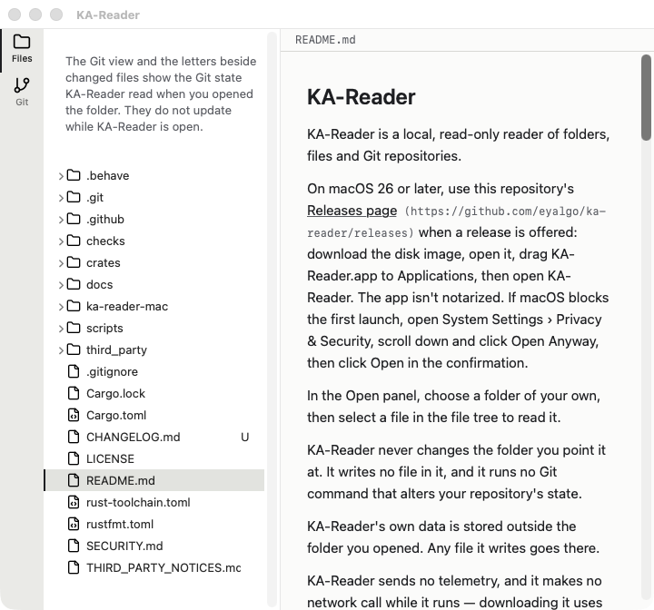

# KA-Reader

KA-Reader is a local, read-only reader of folders, files and Git repositories.

Built by [KensaiApp](https://github.com/eyalgo/kensaiapp), a system of AI roles on Claude Code.

**[Install](https://github.com/eyalgo/ka-reader#install) · [Releases](https://github.com/eyalgo/ka-reader/releases) · [Build cost](https://github.com/eyalgo/ka-reader/blob/main/docs/build_cost.md) · [KensaiApp](https://github.com/eyalgo/kensaiapp)**

### Install

On macOS 26 or later, use this repository's [Releases page](https://github.com/eyalgo/ka-reader/releases) when a release is offered: download the disk image, open it, drag KA-Reader.app to Applications, then open KA-Reader. The app isn't notarized. If macOS blocks the first launch, open System Settings › Privacy & Security, scroll down and click Open Anyway, then click Open in the confirmation.

In the Open panel, choose a folder of your own, then select a file in the file tree to read it.

KA-Reader never changes the folder you point it at. It writes no file in it, and it runs no Git command that alters your repository's state.

KA-Reader's own data is stored outside the folder you opened. Any file it writes goes there.

KA-Reader sends no telemetry, and it makes no network call while it runs — downloading it uses the network; using it does not.

## Promises and limits

KA-Reader is before version 1.0.0. Until 1.0.0, anything in it may change: what it does, how it looks, and how you start it.

Issues and questions are welcome and are read when there is time. There is no response time, no commitment to fix, and no promise that a fix arrives. Security reports have a private channel and are read on the same terms.

If KA-Reader can no longer be maintained, this repository is archived on that day, so you can see it rather than guess.

KA-Reader is used with a mouse. It has no keyboard navigation, and it makes no promise about screen readers or other assistive technology. Neither is planned: keyboard navigation is outside what KA-Reader is built to become.

## Status

You can choose a folder in the Open panel, browse its file tree and select a file to read. The reading panel renders Markdown. You can switch between Files and Git to see the Git state read from a repository.

## Known gaps

<!-- git-read-at-open:start -->

The Git view and the letters beside changed files show the Git state KA-Reader read when you opened the folder. They do not update while KA-Reader is open.

If a repository is created at the root of the folder you opened while KA-Reader is open, KA-Reader doesn't show its Git state until you start KA-Reader again.

<!-- git-read-at-open:end -->

## What it is

A tool optimized for **inspection rather than authoring** — select files, browse the
folder's file tree, and check its Git state in a familiar editor-like shell, without the
complexity of a full IDE. It takes one local folder at a time, a Git repository or not: when
the folder is a repository, the Git view shows its state; when it is not, the Git view is there
and shows nothing. The intentionally narrow v1:

- Read-only code viewing with syntax highlighting for Python, shell, JavaScript, JSON, YAML and
  TOML; any other text file is shown as plain text. Markdown is rendered.
- Sidebar toggle between **Files** and **Git**.
- Live refresh: a change on disk appears in the view with nothing for you to do.
- Fast file switching in a familiar workbench-style shell.
- Minimal chrome. The only input KA-Reader ever needs is which folder to view.

## Stack

One macOS application bundle, running as one process: an AppKit shell in Swift (`ka-reader-mac`)
over a Rust library that does all the reading (`crates/ka-reader-core`), reached through a C
interface (`crates/ka-reader-bridge`). There is no web engine in it. The fourteen Lucide icons ship
inside the bundle. A shell harness under `checks/` proves the read-only and no-network promises
on every build. The decisions and their reasons are in [`docs/adr/`](docs/adr/README.md).

## Roadmap

1. **v1** — the file tree, reading with highlighting, the Git view, live refresh, a remembered
   theme, and a stranger picking it up from this README alone — against a plain folder as
   against a repository.
2. **Inside done, beyond v1** — diffs, commit history with branches drawn as branches, and
   switching the viewed folder without restarting (always one at a time).
3. **1.0.0** — the version number becomes a promise.

The order, slice by slice, is `docs/SDD.md` § 6.

Sidebar search and filtering, pane resizing and keyboard navigation are outside what KA-Reader is built to become.

## Name

*KA-Reader* was called *Nozoki* (覗き — *"to peek / peer in"*) until 2026-10-08.
The tool is the same: it lets you look into a folder,
but never reach in and change it.

## Built by KensaiApp

KA-Reader is built by [KensaiApp](https://github.com/eyalgo/kensaiapp), a system of AI roles that
carries a software change from first ask to merged code. What that cost in Claude runs, tokens and
money is in [`docs/build_cost.md`](https://github.com/eyalgo/ka-reader/blob/main/docs/build_cost.md).
