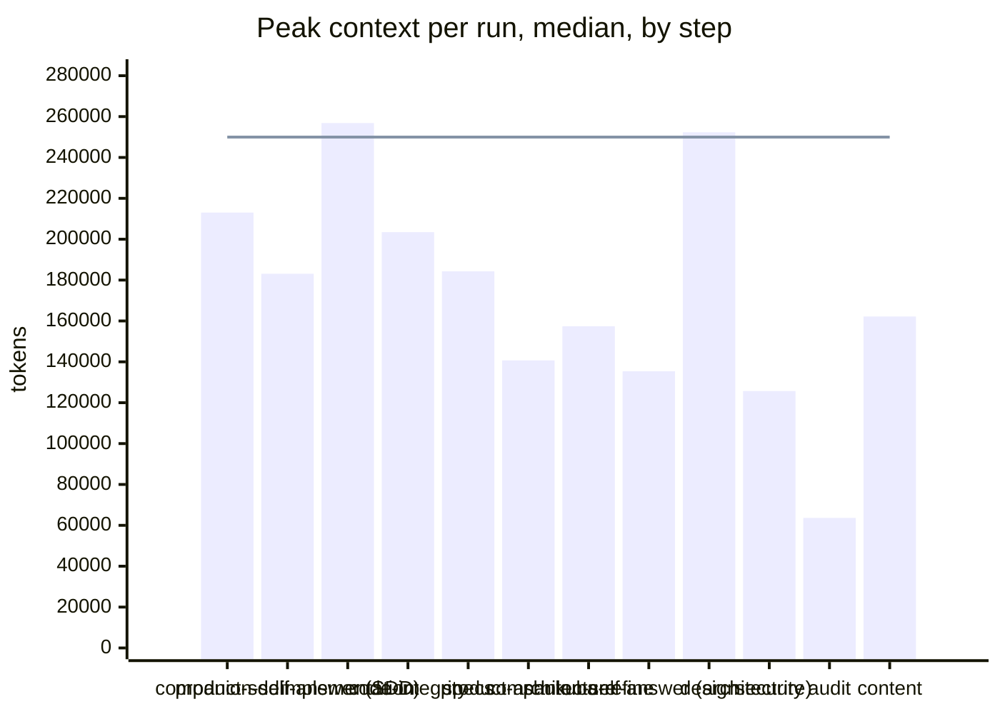
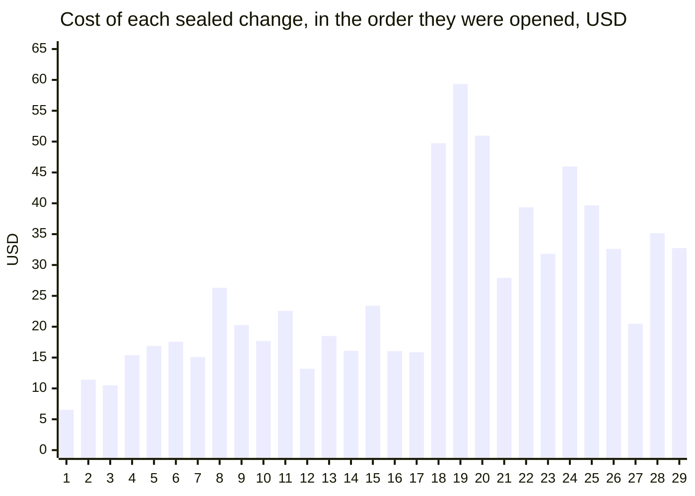
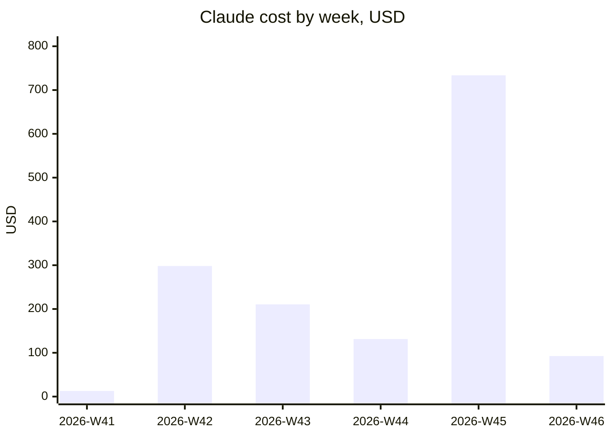

# What building ka-reader cost

ka-reader was built by KensaiApp's roles, each step a Claude Code run. From 2026-10-08 to 2026-11-09 that took **732 runs**, **18,123 model requests** and **$1,479.24** of Claude usage. One change, every walk it took counted, typically cost **$20.49**.

Every figure below is what Claude Code reported for each request, never a price worked out from tokens. Runs on Codex, and interactive sessions, are not counted. How each figure is measured is at the end. A step is one of KensaiApp's skills; its [glossary](https://github.com/eyalgo/kensaiapp/blob/main/about/glossary.md) says what each one does. The figures start when telemetry was first received for this project; work done before 2026-10-08 is not in them.

## Cost by model and effort

| model · effort | runs | entry | peak, median | peak, max | requests/run | minutes/run | $/run | $ total | cache hit |
|---|--:|--:|--:|--:|--:|--:|--:|--:|--:|
| claude-opus-5-5 · high | 187 | 23,850 | 163,598 | 412,632 | 36 | 6.3 | $3.02 | $565.31 | 96.7% |
| claude-fable-5-1 · high | 63 | 27,124 | 192,194 | 375,065 | 16 | 8.7 | $6.91 | $435.05 | 90.4% |
| claude-sonnet-5-5 · medium | 372 | 24,216 | 77,446 | 414,455 | 12 | 1.2 | $0.78 | $288.52 | 95.4% |
| claude-opus-5-5 · medium | 54 | 26,396 | 140,324 | 215,747 | 35 | 4.7 | $2.16 | $116.81 | 96.4% |
| claude-fable-5-1 · medium | 16 | 25,056 | 125,713 | 215,738 | 14 | 3.2 | $3.53 | $56.51 | 88.4% |
| claude-sonnet-5-5 · low | 27 | 23,815 | 52,432 | 60,867 | 9 | 0.7 | $0.27 | $7.23 | 89.2% |
| claude-opus-5-5 · default | 4 | 24,530 | 98,991 | 105,172 | 14 | 1.5 | $1.10 | $4.41 | 90.4% |
| claude-sonnet-5-5 · high | 3 | 24,773 | 171,146 | 184,545 | 20 | 5.3 | $1.26 | $3.78 | 93.6% |
| qwen3-coder:30b · default | 2 | 6,180 | 34,854 | 41,847 | 40 | 3.3 | $0.77 | $1.54 | 96.9% |
| claude-haiku-5-5 · low | 3 | 24,820 | 48,492 | 77,829 | 12 | 0.7 | $0.02 | $0.06 | 89.6% |
| claude-haiku-5-5 · medium | 1 | 25,037 | 64,271 | 64,271 | 15 | 1.1 | $0.02 | $0.02 | 91.3% |

## Context: where each run starts and how large it grows

A run starts with its instructions and the files it is handed (*entry*). Each request then carries the whole conversation so far, so the context grows until the run ends (*peak*). The line is the 250,000-token cap the change chain sets on a developer run; it takes effect only once the task in progress finishes, so a run can pass it.

| step | runs | entry | peak, median | peak, max | over the cap | requests/run | minutes/run | $/run | $ total | cache hit |
|---|--:|--:|--:|--:|--:|--:|--:|--:|--:|--:|
| product-sdd | 32 | 27,372 | 213,024 | 375,065 | 9 | 16 | 9.9 | $7.37 | $235.95 | 90.2% |
| companion-self-answer (SDD) | 31 | 27,124 | 183,083 | 283,685 | 3 | 16 | 8.0 | $6.42 | $199.09 | 90.5% |
| development-implementation | 76 | 24,987 | 256,824 | 414,455 | 39 | 42 | 26.1 | $2.09 | $159.13 | 97.3% |
| development-code-integrity | 33 | 24,504 | 203,431 | 367,577 | 9 | 46 | 41.8 | $3.93 | $129.61 | 97.3% |
| development-specs | 34 | 23,127 | 184,292 | 268,531 | 3 | 50 | 9.4 | $3.60 | $122.54 | 97.2% |
| product-architecture | 36 | 23,850 | 140,688 | 229,117 | 0 | 33 | 4.8 | $2.32 | $83.47 | 96.3% |
| shukuba-refine | 30 | 26,670 | 157,402 | 215,747 | 0 | 43 | 5.5 | $2.72 | $81.53 | 96.9% |
| companion-self-answer (architecture) | 33 | 24,243 | 135,360 | 200,103 | 0 | 30 | 4.5 | $2.21 | $72.87 | 95.8% |
| development-design | 12 | 23,992 | 252,293 | 412,632 | 7 | 62 | 14.6 | $5.67 | $68.04 | 97.3% |
| development-security | 16 | 25,056 | 125,713 | 215,738 | 0 | 14 | 3.2 | $3.53 | $56.51 | 88.4% |
| development-audit | 137 | 23,635 | 63,637 | 113,290 | 0 | 10 | 1.0 | $0.36 | $49.42 | 88.9% |
| development-content | 17 | 22,856 | 162,186 | 203,604 | 0 | 23 | 5.5 | $2.20 | $37.33 | 94.0% |
| development-plan | 31 | 23,750 | 116,413 | 226,778 | 0 | 16 | 2.3 | $0.86 | $26.55 | 92.6% |
| nemawashi-refine | 9 | 26,937 | 139,937 | 188,748 | 0 | 30 | 3.8 | $2.23 | $20.08 | 96.1% |
| tobiishi-seal | 31 | 26,923 | 102,874 | 128,325 | 0 | 12 | 1.2 | $0.53 | $16.42 | 89.9% |
| changelog-line | 15 | 23,897 | 80,547 | 95,200 | 0 | 18 | 1.7 | $1.01 | $15.20 | 92.7% |
| product-fdr | 5 | 25,366 | 173,071 | 292,176 | 1 | 36 | 4.6 | $2.88 | $14.38 | 96.6% |
| tobiishi-open | 35 | 26,588 | 71,459 | 100,082 | 0 | 10 | 0.8 | $0.36 | $12.61 | 88.1% |
| companion-self-answer (FDR) | 3 | 23,803 | 178,012 | 226,502 | 0 | 33 | 4.3 | $2.60 | $7.79 | 95.5% |
| shukuba-open | 23 | 26,481 | 61,534 | 91,762 | 0 | 11 | 0.8 | $0.33 | $7.61 | 89.1% |
| shukuba-retire | 26 | 23,872 | 53,272 | 60,867 | 0 | 10 | 0.7 | $0.28 | $7.29 | 89.6% |
| product-prd | 3 | 27,073 | 128,481 | 138,889 | 0 | 28 | 4.2 | $1.83 | $5.49 | 94.9% |
| product-srs | 3 | 27,424 | 117,036 | 165,242 | 0 | 27 | 2.7 | $1.81 | $5.43 | 95.2% |
| seeds-from-product-docs | 5 | 25,335 | 130,106 | 158,433 | 0 | 22 | 2.0 | $0.87 | $4.34 | 93.7% |
| companion-self-answer (SRS) | 2 | 27,145 | 158,253 | 174,702 | 0 | 24 | 3.4 | $2.12 | $4.24 | 94.6% |
| stations-from-seed | 10 | 26,464 | 75,160 | 133,748 | 0 | 11 | 0.9 | $0.41 | $4.06 | 89.8% |
| readme-status | 12 | 22,789 | 56,790 | 97,581 | 0 | 9 | 0.6 | $0.32 | $3.86 | 87.7% |
| companion-self-answer (CONTENT) | 3 | 24,773 | 171,146 | 184,545 | 0 | 20 | 5.3 | $1.26 | $3.78 | 93.6% |
| product-card | 3 | 24,294 | 100,834 | 105,172 | 0 | 14 | 1.7 | $1.17 | $3.52 | 90.6% |
| product-uxd | 1 | 27,985 | 193,826 | 193,826 | 0 | 43 | 7.5 | $3.30 | $3.30 | 96.9% |
| companion-self-answer (UXD) | 1 | 27,148 | 208,010 | 208,010 | 0 | 38 | 6.6 | $3.30 | $3.30 | 96.2% |
| nemawashi-pick | 8 | 26,420 | 53,936 | 85,709 | 0 | 10 | 0.7 | $0.40 | $3.18 | 89.9% |
| companion-self-answer (PRD) | 2 | 27,146 | 116,217 | 118,937 | 0 | 20 | 2.3 | $1.45 | $2.90 | 93.9% |
| companion-self-answer (fdr) | 1 | 24,817 | 171,805 | 171,805 | 0 | 31 | 4.8 | $2.58 | $2.58 | 95.7% |
| first-what-left | 1 | 25,594 | 143,209 | 143,209 | 0 | 37 | 6.3 | $2.02 | $2.02 | 95.8% |
| product-content | 3 | 25,738 | 92,645 | 133,811 | 0 | 14 | 1.3 | $0.61 | $1.82 | 92.1% |
| nemawashi-unpick | 1 | 25,929 | 89,288 | 89,288 | 0 | 11 | 0.7 | $0.89 | $0.89 | 89.4% |
| seed-pick | 2 | 27,158 | 62,305 | 68,223 | 0 | 10 | 0.6 | $0.31 | $0.61 | 89.2% |
| nemawashi-retire | 5 | 23,719 | 47,487 | 77,829 | 0 | 11 | 0.7 | $0.09 | $0.46 | 88.4% |
| dependency-repair | 1 | 25,037 | 64,271 | 64,271 | 0 | 15 | 1.1 | $0.02 | $0.02 | 91.3% |

## Writing the product's documents

Before any change, KensaiApp's definition roles write the product down, document by document. Each document's run parks what it cannot settle in a companion file of open questions, and a later run answers them and writes the document again. Writing the documents cost **$646.62** in all.

| document | runs | writing | answering its questions | total |
|---|--:|--:|--:|--:|
| SDD | 63 | $235.95 | $199.09 | $435.05 |
| architecture | 69 | $83.47 | $72.87 | $156.34 |
| FDR | 8 | $14.38 | $7.79 | $22.17 |
| SRS | 5 | $5.43 | $4.24 | $9.67 |
| PRD | 5 | $5.49 | $2.90 | $8.39 |
| CONTENT | 6 | $1.82 | $3.78 | $5.60 |
| project card | 3 | $3.52 | $0.00 | $3.52 |
| UXD | 1 | $0.00 | $3.30 | $3.30 |
| fdr | 1 | $0.00 | $2.58 | $2.58 |

## What a change costs

29 changes were walked to their seal. A change typically cost **$20.49**, the highest $59.33, $748.99 in all. 11 of them halted and were resumed, so their cost spans more than one walk; each change is counted whole. 2 more were not sealed when the data ends, dropped or still being walked, and are left out.

## What a walk costs

A walk is one launch of a chain, and every run it started: *walk* carries a change from its station to its seal and the review after it, *change* carries a change toward its seal (the older chain), *product* and *agari* write the product's documents, *build-idea* moves the journey between changes.

| chain | walks | median | highest | total |
|---|--:|--:|--:|--:|
| product | 36 | $15.77 | $67.08 | $630.46 |
| walk | 20 | $22.99 | $59.33 | $439.28 |
| change | 30 | $10.05 | $26.30 | $322.25 |
| (none) | 1 | $47.90 | $47.90 | $47.90 |
| build-idea | 15 | $0.85 | $4.99 | $26.06 |
| development | 3 | $4.72 | $5.77 | $13.30 |

## The most expensive runs

| started (UTC) | step | model · effort | cost | requests | peak | minutes |
|---|---|---|--:|--:|--:|--:|
| 2026-11-06 16:19 | companion-self-answer (SDD) | claude-fable-5-1 · high | $17.78 | 49 | 207,994 | 24 |
| 2026-11-06 15:56 | product-sdd | claude-fable-5-1 · high | $13.87 | 19 | 365,610 | 23 |
| 2026-10-21 22:15 | companion-self-answer (SDD) | claude-fable-5-1 · high | $13.02 | 32 | 283,685 | 16 |
| 2026-11-07 04:10 | product-sdd | claude-fable-5-1 · high | $11.72 | 17 | 324,024 | 20 |
| 2026-11-06 17:15 | product-sdd | claude-fable-5-1 · high | $10.97 | 16 | 375,065 | 11 |

## Cost by week

## How it was measured

- Source: the OpenTelemetry events Claude Code sent while the runs worked, received by ka-telemetry, keeping the runs labelled `kensai.instance=kensaiapp-opensource` and `kensai.project=ka-reader`.
- A run is one `kensai.run_id`. Only `claude_code.api_request` events of the main agent count; helper calls inside a run, such as a web search or fetch, are left out.
- A request's context is its input + cache-read + cache-write tokens. *Entry* is a run's first request's context, *peak* its largest.
- *Cost* is the `cost_usd` Claude Code reported. *$/run* is the average, so runs × $/run is the total. *Cache hit* is cache-read tokens over all input tokens.
- *Minutes* run from a run's first request to its last. A walk is every run sharing one `kensai.walk_id`.
- A change is the walks of the walk, change and development chains from one walk that opens it and writes its spec to the next, in start order; a project walks one change at a time. A walk that only opened a change counts toward the change after it. A change counts once a walk sealed it.
- A run started by a launcher arm rather than a skill, such as the self-answer of a document's open questions, is named by that arm and the document.
- Generated 2026-11-09 from data up to 2026-11-09 13:10 UTC.
