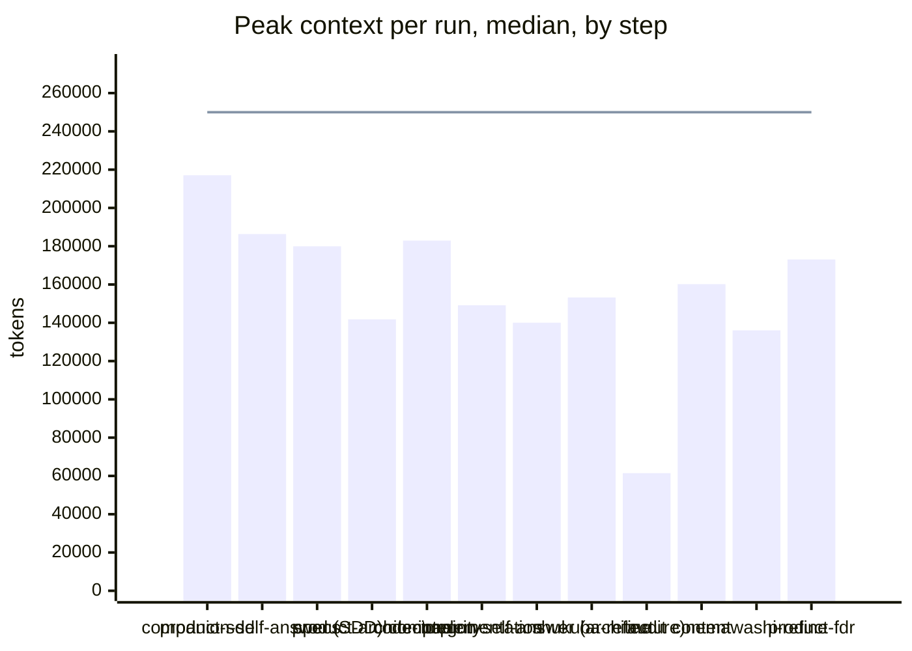
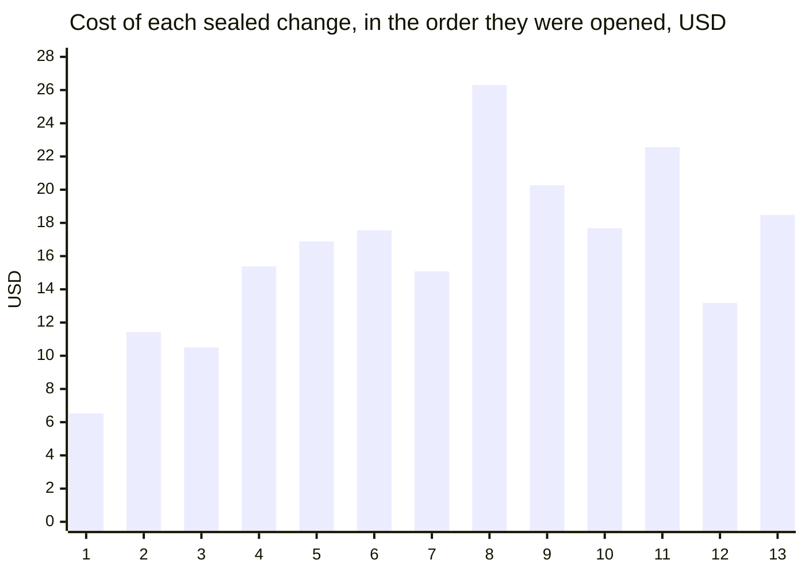
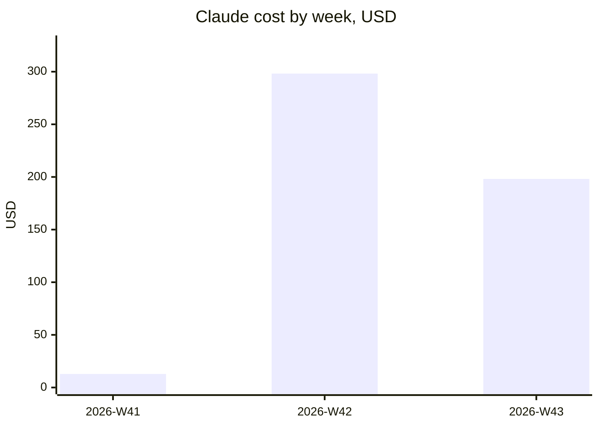

# What building ka-reader cost

ka-reader was built by KensaiApp's roles, each step a Claude Code run. From 2026-10-08 to 2026-10-23 that took **316 runs**, **6,920 model requests** and **$509.20** of Claude usage. One change, every walk it took counted, typically cost **$16.89**.

Every figure below is what Claude Code reported for each request, never a price worked out from tokens. Runs on Codex, and interactive sessions, are not counted. How each figure is measured is at the end. A step is one of KensaiApp's skills; its [glossary](https://github.com/eyalgo/kensaiapp/blob/main/about/glossary.md) says what each one does. The figures start when telemetry was first received for this project; work done before 2026-10-08 is not in them.

## Cost by model and effort

| model · effort | runs | entry | peak, median | peak, max | requests/run | minutes/run | $/run | $ total | cache hit |
|---|--:|--:|--:|--:|--:|--:|--:|--:|--:|
| claude-opus-5-5 · high | 79 | 23,045 | 156,199 | 292,176 | 35 | 6.1 | $2.65 | $209.54 | 96.3% |
| claude-fable-5-1 · high | 21 | 25,679 | 192,272 | 348,248 | 14 | 8.7 | $6.75 | $141.85 | 89.6% |
| claude-sonnet-5-5 · medium | 171 | 23,664 | 68,410 | 288,404 | 11 | 1.0 | $0.57 | $97.24 | 94.1% |
| claude-opus-5-5 · medium | 20 | 26,026 | 144,650 | 215,747 | 37 | 4.9 | $2.45 | $49.05 | 96.5% |
| claude-opus-5-5 · default | 4 | 24,530 | 98,991 | 105,172 | 14 | 1.5 | $1.10 | $4.41 | 90.4% |
| claude-sonnet-5-5 · low | 17 | 23,161 | 51,424 | 56,907 | 8 | 0.6 | $0.26 | $4.35 | 88.7% |
| qwen3-coder:30b · default | 2 | 6,180 | 34,854 | 41,847 | 40 | 3.3 | $0.77 | $1.54 | 96.9% |
| claude-sonnet-5-5 · high | 1 | 23,071 | 160,969 | 160,969 | 25 | 3.6 | $1.18 | $1.18 | 94.7% |
| claude-haiku-5-5 · low | 1 | 23,719 | 77,829 | 77,829 | 16 | 1.0 | $0.03 | $0.03 | 89.9% |

## Context: where each run starts and how large it grows

A run starts with its instructions and the files it is handed (*entry*). Each request then carries the whole conversation so far, so the context grows until the run ends (*peak*). The line is the 250,000-token cap the change chain sets on a developer run; it takes effect only once the task in progress finishes, so a run can pass it.

| step | runs | entry | peak, median | peak, max | over the cap | requests/run | minutes/run | $/run | $ total | cache hit |
|---|--:|--:|--:|--:|--:|--:|--:|--:|--:|--:|
| product-sdd | 11 | 25,679 | 217,064 | 348,248 | 5 | 14 | 9.3 | $7.07 | $77.81 | 89.2% |
| companion-self-answer (SDD) | 10 | 25,418 | 186,347 | 283,685 | 2 | 15 | 8.4 | $6.40 | $64.04 | 90.0% |
| development-specs | 15 | 22,000 | 179,938 | 219,351 | 0 | 45 | 8.5 | $3.16 | $47.45 | 96.7% |
| product-architecture | 19 | 23,048 | 141,793 | 218,264 | 0 | 34 | 5.7 | $2.34 | $44.48 | 96.2% |
| development-code-integrity | 13 | 22,493 | 182,933 | 258,482 | 1 | 46 | 12.7 | $3.32 | $43.12 | 97.1% |
| development-implementation | 26 | 23,753 | 149,164 | 288,404 | 7 | 28 | 19.9 | $1.63 | $42.31 | 97.1% |
| companion-self-answer (architecture) | 16 | 23,593 | 140,048 | 200,103 | 0 | 28 | 4.8 | $2.24 | $35.86 | 95.7% |
| shukuba-refine | 14 | 25,880 | 153,235 | 215,747 | 0 | 42 | 5.0 | $2.55 | $35.68 | 96.6% |
| development-audit | 59 | 22,514 | 61,481 | 98,018 | 0 | 10 | 0.9 | $0.33 | $19.38 | 88.7% |
| development-content | 8 | 22,738 | 160,198 | 203,604 | 0 | 22 | 5.2 | $2.27 | $18.14 | 93.5% |
| nemawashi-refine | 6 | 26,703 | 136,035 | 188,748 | 0 | 29 | 3.8 | $2.23 | $13.37 | 96.2% |
| product-fdr | 3 | 24,453 | 173,071 | 292,176 | 1 | 36 | 4.6 | $3.29 | $9.86 | 96.7% |
| development-plan | 14 | 22,108 | 97,683 | 118,854 | 0 | 13 | 1.7 | $0.57 | $8.00 | 90.0% |
| tobiishi-seal | 14 | 25,836 | 101,952 | 114,664 | 0 | 12 | 1.0 | $0.51 | $7.21 | 89.9% |
| tobiishi-open | 18 | 25,787 | 66,364 | 100,082 | 0 | 9 | 0.7 | $0.33 | $5.99 | 87.7% |
| companion-self-answer (FDR) | 2 | 23,349 | 202,257 | 226,502 | 0 | 28 | 4.0 | $2.74 | $5.48 | 95.0% |
| shukuba-open | 15 | 25,785 | 58,833 | 88,573 | 0 | 11 | 0.7 | $0.32 | $4.73 | 88.7% |
| shukuba-retire | 16 | 23,384 | 51,616 | 56,907 | 0 | 10 | 0.7 | $0.28 | $4.41 | 89.5% |
| product-card | 3 | 24,294 | 100,834 | 105,172 | 0 | 14 | 1.7 | $1.17 | $3.52 | 90.6% |
| nemawashi-pick | 7 | 26,382 | 52,898 | 85,709 | 0 | 9 | 0.5 | $0.41 | $2.89 | 90.1% |
| readme-status | 8 | 22,570 | 57,786 | 97,581 | 0 | 9 | 0.6 | $0.33 | $2.65 | 87.9% |
| stations-from-seed | 7 | 26,403 | 72,069 | 85,258 | 0 | 9 | 0.8 | $0.36 | $2.50 | 88.1% |
| seeds-from-product-docs | 3 | 24,656 | 126,200 | 130,106 | 0 | 16 | 1.9 | $0.74 | $2.22 | 91.6% |
| first-what-left | 1 | 25,594 | 143,209 | 143,209 | 0 | 37 | 6.3 | $2.02 | $2.02 | 95.8% |
| product-prd | 1 | 25,883 | 124,982 | 124,982 | 0 | 21 | 3.9 | $1.62 | $1.62 | 93.5% |
| product-srs | 1 | 25,719 | 117,036 | 117,036 | 0 | 23 | 2.2 | $1.50 | $1.50 | 94.2% |
| companion-self-answer (CONTENT) | 1 | 23,071 | 160,969 | 160,969 | 0 | 25 | 3.6 | $1.18 | $1.18 | 94.7% |
| nemawashi-unpick | 1 | 25,929 | 89,288 | 89,288 | 0 | 11 | 0.7 | $0.89 | $0.89 | 89.4% |
| product-content | 1 | 24,036 | 84,840 | 84,840 | 0 | 13 | 1.1 | $0.46 | $0.46 | 90.5% |
| nemawashi-retire | 3 | 23,132 | 45,711 | 77,829 | 0 | 7 | 0.4 | $0.14 | $0.42 | 87.6% |

## Writing the product's documents

Before any change, KensaiApp's definition roles write the product down, document by document. Each document's run parks what it cannot settle in a companion file of open questions, and a later run answers them and writes the document again. Writing the documents cost **$245.81** in all.

| document | runs | writing | answering its questions | total |
|---|--:|--:|--:|--:|
| SDD | 21 | $77.81 | $64.04 | $141.85 |
| architecture | 35 | $44.48 | $35.86 | $80.34 |
| FDR | 5 | $9.86 | $5.48 | $15.34 |
| project card | 3 | $3.52 | $0.00 | $3.52 |
| CONTENT | 2 | $0.46 | $1.18 | $1.64 |
| PRD | 1 | $1.62 | $0.00 | $1.62 |
| SRS | 1 | $1.50 | $0.00 | $1.50 |

## What a change costs

13 changes were walked to their seal. A change typically cost **$16.89**, the highest $26.30, $211.85 in all. 5 of them halted and were resumed, so their cost spans more than one walk; each change is counted whole. 2 more were not sealed when the data ends, dropped or still being walked, and are left out.

## What a walk costs

A walk is one launch of a chain, and every run it started: *change* carries a change toward its seal, *product* and *agari* write the product's documents, *build-idea* moves the journey between changes.

| chain | walks | median | highest | total |
|---|--:|--:|--:|--:|
| product | 15 | $13.30 | $29.15 | $226.35 |
| change | 24 | $8.50 | $26.30 | $211.94 |
| (none) | 1 | $45.96 | $45.96 | $45.96 |
| development | 3 | $4.72 | $5.77 | $13.30 |
| build-idea | 9 | $0.85 | $3.06 | $11.65 |

## The most expensive runs

| started (UTC) | step | model · effort | cost | requests | peak | minutes |
|---|---|---|--:|--:|--:|--:|
| 2026-10-21 22:15 | companion-self-answer (SDD) | claude-fable-5-1 · high | $13.02 | 32 | 283,685 | 16 |
| 2026-10-22 01:49 | product-sdd | claude-fable-5-1 · high | $10.02 | 21 | 314,949 | 14 |
| 2026-10-16 18:00 | product-sdd | claude-fable-5-1 · high | $9.91 | 18 | 348,248 | 10 |
| 2026-10-20 14:29 | product-sdd | claude-fable-5-1 · high | $8.91 | 17 | 282,042 | 11 |
| 2026-10-16 21:34 | product-sdd | claude-fable-5-1 · high | $8.74 | 17 | 294,193 | 9 |

## Cost by week

## How it was measured

- Source: the OpenTelemetry events Claude Code sent while the runs worked, received by ka-telemetry, keeping the runs labelled `kensai.instance=kensaiapp-opensource` and `kensai.project=ka-reader`.
- A run is one `kensai.run_id`. Only `claude_code.api_request` events of the main agent count; helper calls inside a run, such as a web search or fetch, are left out.
- A request's context is its input + cache-read + cache-write tokens. *Entry* is a run's first request's context, *peak* its largest.
- *Cost* is the `cost_usd` Claude Code reported. *$/run* is the average, so runs × $/run is the total. *Cache hit* is cache-read tokens over all input tokens.
- *Minutes* run from a run's first request to its last. A walk is every run sharing one `kensai.walk_id`.
- A change is the walks of the change and development chains from one walk that opens it and writes its spec to the next, in start order; a project walks one change at a time. A walk that only opened a change counts toward the change after it. A change counts once a walk sealed it.
- A run started by a launcher arm rather than a skill, such as the self-answer of a document's open questions, is named by that arm and the document.
- Generated 2026-10-23 from data up to 2026-10-23 08:02 UTC.
