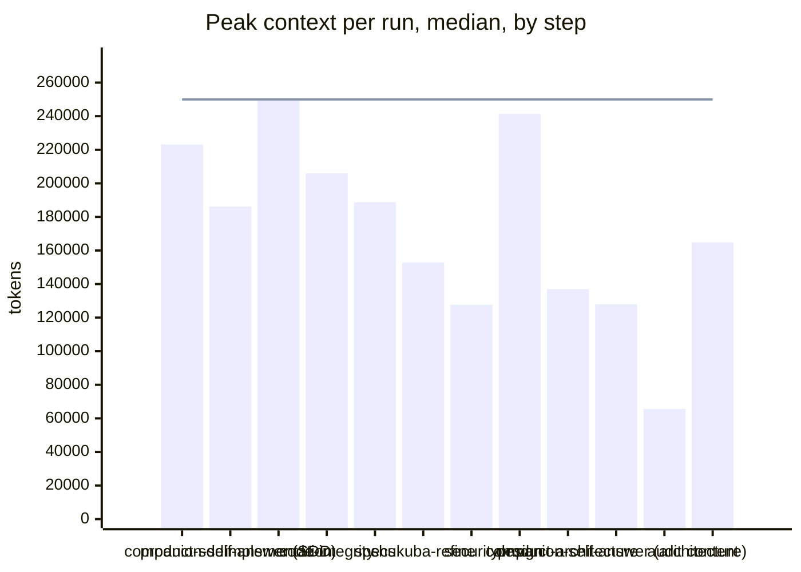
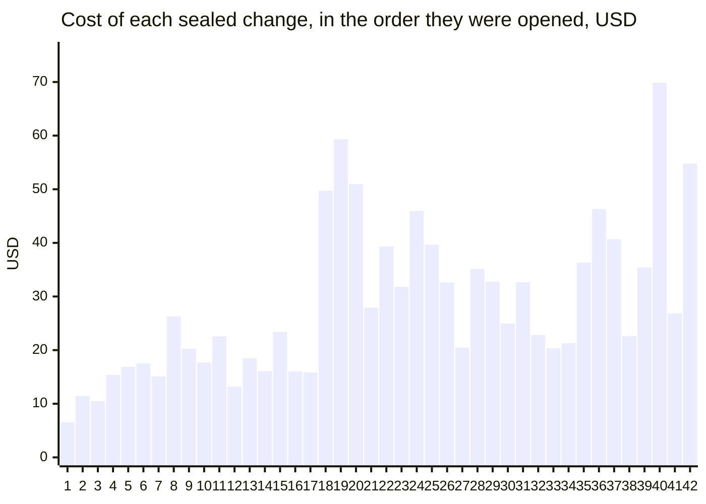
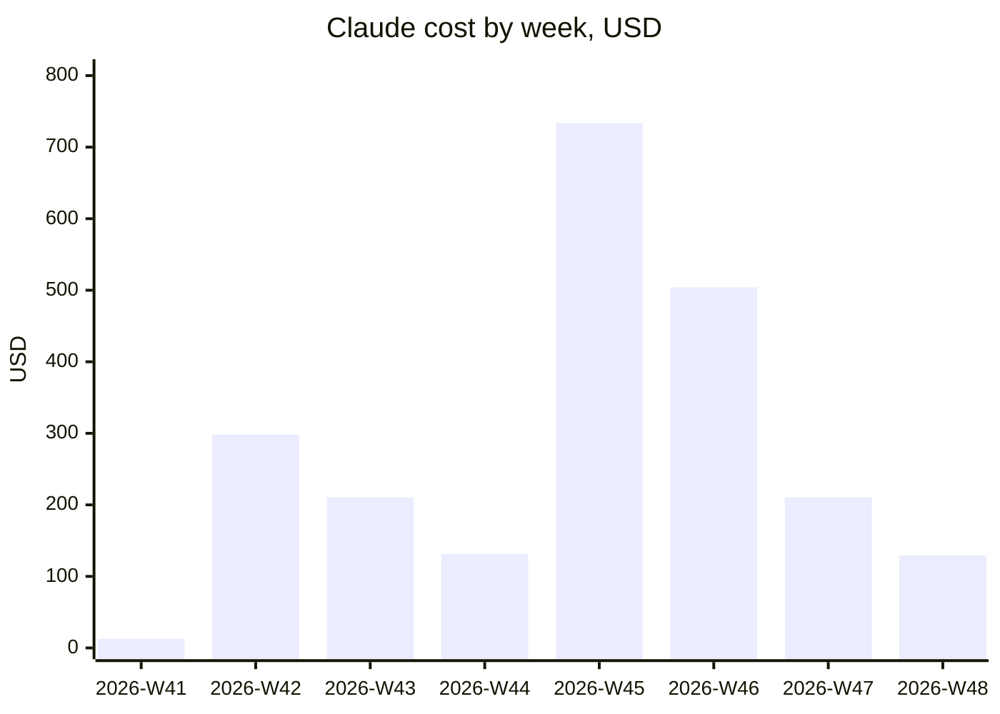

# What building ka-reader cost

ka-reader was built by KensaiApp's roles, each step a Claude Code run. From 2026-10-08 to 2026-11-25 that took **1,056 runs**, **26,549 model requests** and **$2,230.27** of Claude usage. One change, every walk it took counted, typically cost **$24.19**.

Every figure below is what Claude Code reported for each request, never a price worked out from tokens. Runs on Codex, and interactive sessions, are not counted. How each figure is measured is at the end. A step is one of KensaiApp's skills; its [glossary](https://github.com/eyalgo/kensaiapp/blob/main/about/glossary.md) says what each one does. The figures start when telemetry was first received for this project; work done before 2026-10-08 is not in them.

## Cost by model and effort

| model · effort | runs | entry | peak, median | peak, max | requests/run | minutes/run | $/run | $ total | cache hit |
|---|--:|--:|--:|--:|--:|--:|--:|--:|--:|
| claude-opus-5-5 · high | 287 | 24,279 | 156,462 | 412,632 | 35 | 6.2 | $3.00 | $860.97 | 96.6% |
| claude-fable-5-1 · high | 83 | 27,127 | 195,093 | 497,602 | 16 | 9.3 | $7.69 | $638.21 | 90.5% |
| claude-sonnet-5-5 · medium | 520 | 24,614 | 80,346 | 414,455 | 12 | 1.2 | $0.80 | $414.10 | 95.3% |
| claude-opus-5-5 · medium | 91 | 26,436 | 129,802 | 215,747 | 26 | 3.8 | $1.95 | $177.24 | 96.2% |
| claude-fable-5-1 · medium | 33 | 25,063 | 127,695 | 215,738 | 14 | 4.3 | $3.64 | $120.03 | 89.0% |
| claude-sonnet-5-5 · low | 27 | 23,815 | 52,432 | 60,867 | 9 | 0.7 | $0.27 | $7.23 | 89.2% |
| claude-sonnet-5-5 · high | 5 | 24,773 | 171,146 | 200,253 | 25 | 5.3 | $1.29 | $6.46 | 94.7% |
| claude-opus-5-5 · default | 4 | 24,530 | 98,991 | 105,172 | 14 | 1.5 | $1.10 | $4.41 | 90.4% |
| qwen3-coder:30b · default | 2 | 6,180 | 34,854 | 41,847 | 40 | 3.3 | $0.77 | $1.54 | 96.9% |
| claude-haiku-5-5 · low | 3 | 24,820 | 48,492 | 77,829 | 12 | 0.7 | $0.02 | $0.06 | 89.6% |
| claude-haiku-5-5 · medium | 1 | 25,037 | 64,271 | 64,271 | 15 | 1.1 | $0.02 | $0.02 | 91.3% |

## Context: where each run starts and how large it grows

A run starts with its instructions and the files it is handed (*entry*). Each request then carries the whole conversation so far, so the context grows until the run ends (*peak*). The line is the 250,000-token cap the change chain sets on a developer run; it takes effect only once the task in progress finishes, so a run can pass it.

| step | runs | entry | peak, median | peak, max | over the cap | requests/run | minutes/run | $/run | $ total | cache hit |
|---|--:|--:|--:|--:|--:|--:|--:|--:|--:|--:|
| product-sdd | 42 | 27,403 | 223,113 | 497,602 | 17 | 16 | 11.0 | $8.65 | $363.18 | 90.5% |
| companion-self-answer (SDD) | 41 | 27,124 | 186,182 | 342,688 | 8 | 16 | 8.4 | $6.71 | $275.03 | 90.6% |
| development-implementation | 114 | 25,057 | 250,477 | 414,455 | 57 | 42 | 35.7 | $2.02 | $230.75 | 97.1% |
| development-code-integrity | 50 | 25,076 | 205,962 | 367,577 | 17 | 49 | 53.3 | $4.29 | $214.45 | 97.1% |
| development-specs | 50 | 23,766 | 188,726 | 268,531 | 3 | 50 | 9.7 | $3.53 | $176.71 | 97.2% |
| shukuba-refine | 46 | 27,227 | 152,876 | 215,747 | 0 | 40 | 5.3 | $2.62 | $120.57 | 96.8% |
| development-security | 33 | 25,063 | 127,695 | 215,738 | 0 | 14 | 4.3 | $3.64 | $120.03 | 89.0% |
| development-design | 25 | 23,994 | 241,364 | 412,632 | 9 | 52 | 11.4 | $4.73 | $118.25 | 97.1% |
| product-architecture | 51 | 24,734 | 137,023 | 229,117 | 0 | 33 | 4.6 | $2.21 | $112.80 | 96.3% |
| companion-self-answer (architecture) | 49 | 24,803 | 127,994 | 212,966 | 0 | 28 | 3.9 | $2.12 | $103.92 | 95.8% |
| development-audit | 201 | 24,197 | 65,626 | 113,290 | 0 | 11 | 1.1 | $0.37 | $73.51 | 88.9% |
| development-content | 24 | 23,532 | 164,856 | 231,498 | 0 | 24 | 5.8 | $2.41 | $57.77 | 94.2% |
| development-plan | 43 | 24,357 | 121,999 | 238,196 | 0 | 18 | 2.6 | $0.94 | $40.51 | 93.1% |
| changelog-line | 32 | 23,898 | 80,062 | 97,394 | 0 | 16 | 1.7 | $0.98 | $31.39 | 92.5% |
| tobiishi-seal | 49 | 27,172 | 94,418 | 128,325 | 0 | 11 | 1.2 | $0.51 | $24.95 | 89.7% |
| tobiishi-open | 53 | 27,145 | 76,943 | 119,680 | 0 | 10 | 0.8 | $0.46 | $24.21 | 89.9% |
| nemawashi-refine | 9 | 26,937 | 139,937 | 188,748 | 0 | 30 | 3.8 | $2.23 | $20.08 | 96.1% |
| product-fdr | 6 | 26,132 | 149,530 | 292,176 | 1 | 32 | 4.1 | $2.70 | $16.21 | 96.5% |
| companion-self-answer (FDR) | 4 | 24,302 | 171,854 | 226,502 | 0 | 29 | 3.8 | $2.46 | $9.84 | 95.3% |
| shukuba-open | 23 | 26,481 | 61,534 | 91,762 | 0 | 11 | 0.8 | $0.33 | $7.61 | 89.1% |
| shukuba-retire | 26 | 23,872 | 53,272 | 60,867 | 0 | 10 | 0.7 | $0.28 | $7.29 | 89.6% |
| product-srs | 4 | 27,424 | 116,294 | 165,242 | 0 | 27 | 2.7 | $1.73 | $6.91 | 95.3% |
| product-prd | 4 | 27,326 | 126,732 | 138,889 | 0 | 24 | 4.1 | $1.69 | $6.74 | 94.6% |
| companion-self-answer (CONTENT) | 5 | 24,773 | 171,146 | 200,253 | 0 | 25 | 5.3 | $1.29 | $6.46 | 94.7% |
| companion-self-answer (SRS) | 3 | 27,145 | 142,110 | 174,702 | 0 | 21 | 3.2 | $1.96 | $5.88 | 93.7% |
| companion-self-answer (UXD) | 2 | 27,662 | 181,268 | 208,010 | 0 | 32 | 5.4 | $2.69 | $5.39 | 95.6% |
| product-design | 2 | 27,966 | 145,682 | 173,872 | 0 | 40 | 4.9 | $2.34 | $4.68 | 96.8% |
| product-uxd | 2 | 28,674 | 147,283 | 193,826 | 0 | 33 | 5.0 | $2.30 | $4.59 | 96.4% |
| seeds-from-product-docs | 5 | 25,335 | 130,106 | 158,433 | 0 | 22 | 2.0 | $0.87 | $4.34 | 93.7% |
| stations-from-seed | 10 | 26,464 | 75,160 | 133,748 | 0 | 11 | 0.9 | $0.41 | $4.06 | 89.8% |
| companion-self-answer (PRD) | 3 | 27,148 | 113,497 | 118,937 | 0 | 17 | 1.9 | $1.33 | $3.98 | 93.1% |
| readme-status | 12 | 22,789 | 56,790 | 97,581 | 0 | 9 | 0.6 | $0.32 | $3.86 | 87.7% |
| product-card | 3 | 24,294 | 100,834 | 105,172 | 0 | 14 | 1.7 | $1.17 | $3.52 | 90.6% |
| change-blind-review | 2 | 25,614 | 115,355 | 130,536 | 0 | 22 | 4.0 | $1.64 | $3.27 | 93.0% |
| nemawashi-pick | 8 | 26,420 | 53,936 | 85,709 | 0 | 10 | 0.7 | $0.40 | $3.18 | 89.9% |
| companion-self-answer (DESIGN) | 2 | 27,134 | 133,592 | 164,645 | 0 | 16 | 1.9 | $1.52 | $3.04 | 91.6% |
| product-content | 5 | 25,738 | 92,645 | 133,811 | 0 | 14 | 1.3 | $0.56 | $2.81 | 91.7% |
| companion-self-answer (fdr) | 1 | 24,817 | 171,805 | 171,805 | 0 | 31 | 4.8 | $2.58 | $2.58 | 95.7% |
| first-what-left | 1 | 25,594 | 143,209 | 143,209 | 0 | 37 | 6.3 | $2.02 | $2.02 | 95.8% |
| red-behaviour | 2 | 24,197 | 80,009 | 96,405 | 0 | 14 | 2.0 | $0.96 | $1.92 | 90.8% |
| nemawashi-unpick | 1 | 25,929 | 89,288 | 89,288 | 0 | 11 | 0.7 | $0.89 | $0.89 | 89.4% |
| seed-pick | 2 | 27,158 | 62,305 | 68,223 | 0 | 10 | 0.6 | $0.31 | $0.61 | 89.2% |
| nemawashi-retire | 5 | 23,719 | 47,487 | 77,829 | 0 | 11 | 0.7 | $0.09 | $0.46 | 88.4% |
| dependency-repair | 1 | 25,037 | 64,271 | 64,271 | 0 | 15 | 1.1 | $0.02 | $0.02 | 91.3% |

## Writing the product's documents

Before any change, KensaiApp's definition roles write the product down, document by document. Each document's run parks what it cannot settle in a companion file of open questions, and a later run answers them and writes the document again. Writing the documents cost **$932.97** in all.

| document | runs | writing | answering its questions | total |
|---|--:|--:|--:|--:|
| SDD | 83 | $363.18 | $275.03 | $638.21 |
| architecture | 100 | $112.80 | $103.92 | $216.72 |
| FDR | 10 | $16.21 | $9.84 | $26.05 |
| SRS | 7 | $6.91 | $5.88 | $12.80 |
| PRD | 7 | $6.74 | $3.98 | $10.72 |
| CONTENT | 10 | $2.81 | $6.46 | $9.27 |
| DESIGN | 4 | $4.68 | $3.04 | $7.71 |
| UXD | 2 | $0.00 | $5.39 | $5.39 |
| project card | 3 | $3.52 | $0.00 | $3.52 |
| fdr | 1 | $0.00 | $2.58 | $2.58 |

## What a change costs

42 changes were walked to their seal. A change typically cost **$24.19**, the highest $69.85, $1,203.95 in all. 16 of them halted and were resumed, so their cost spans more than one walk; each change is counted whole. 2 more were not sealed when the data ends, dropped or still being walked, and are left out.

## What a walk costs

A walk is one launch of a chain, and every run it started: *walk* carries a change from its station to its seal and the review after it, *change* carries a change toward its seal (the older chain), *product* and *agari* write the product's documents, *build-idea* moves the journey between changes.

| chain | walks | median | highest | total |
|---|--:|--:|--:|--:|
| product | 50 | $17.23 | $67.08 | $918.09 |
| walk | 46 | $20.30 | $59.33 | $892.42 |
| change | 31 | $10.26 | $26.30 | $332.50 |
| (none) | 1 | $47.90 | $47.90 | $47.90 |
| build-idea | 15 | $0.85 | $4.99 | $26.06 |
| development | 3 | $4.72 | $5.77 | $13.30 |

## The most expensive runs

| started (UTC) | step | model · effort | cost | requests | peak | minutes |
|---|---|---|--:|--:|--:|--:|
| 2026-11-24 15:34 | product-sdd | claude-fable-5-1 · high | $22.39 | 26 | 453,345 | 43 |
| 2026-11-18 21:38 | product-sdd | claude-fable-5-1 · high | $18.86 | 20 | 497,602 | 39 |
| 2026-11-06 16:19 | companion-self-answer (SDD) | claude-fable-5-1 · high | $17.78 | 49 | 207,994 | 24 |
| 2026-11-10 22:15 | product-sdd | claude-fable-5-1 · high | $16.92 | 23 | 399,711 | 35 |
| 2026-11-14 21:37 | product-sdd | claude-fable-5-1 · high | $15.00 | 21 | 440,541 | 23 |

## Cost by week

## How it was measured

- Source: the OpenTelemetry events Claude Code sent while the runs worked, received by ka-telemetry, keeping the runs labelled `kensai.instance=kensaiapp-opensource` and `kensai.project=ka-reader`.
- A run is one `kensai.run_id`. Only `claude_code.api_request` events of the main agent count; helper calls inside a run, such as a web search or fetch, are left out.
- A request's context is its input + cache-read + cache-write tokens. *Entry* is a run's first request's context, *peak* its largest.
- *Cost* is the `cost_usd` Claude Code reported. *$/run* is the average, so runs × $/run is the total. *Cache hit* is cache-read tokens over all input tokens.
- *Minutes* run from a run's first request to its last. A walk is every run sharing one `kensai.walk_id`.
- A change is the walks of the walk, change and development chains from one walk that opens it and writes its spec to the next, in start order; a project walks one change at a time. A walk that only opened a change counts toward the change after it. A change counts once a walk sealed it.
- A run started by a launcher arm rather than a skill, such as the self-answer of a document's open questions, is named by that arm and the document.
- Generated 2026-11-25 from data up to 2026-11-25 03:03 UTC.
